# CastBox TV

Turn an Android TV box into a **DLNA / UPnP music renderer** with a built-in
**music visualizer**. Cast from Symfonium, BubbleUPnP, foobar2000 or any other
DLNA controller, and the TV shows the cover art, track info and an animated
background that reacts to the audio.

<p align="center">
  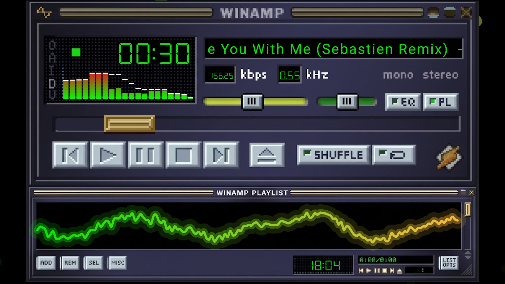
</p>

## Features

- **DLNA/UPnP audio renderer.** It shows up as a device in any controller app,
  with play, pause, seek, next, previous and volume.
- **Crossfade** between tracks, with a configurable duration and curve.
- **Built-in visualizer** with 48 presets, including a Winamp skin, and a
  live editor (the Visualiser Studio).
- **Milkdrop support.** projectM 4 renders classic `.milk` presets, with three
  bundled packs (Classic, Full, Butterchurn) plus your own favorites.
- **Cover-art colors.** Presets can pick up the palette of the current album.
- **Phone-friendly web interface** on port `8092` to change everything from the couch.
- Runs on **armeabi-v7a** and **arm64-v8a** devices (Android 8.0+).

## Visualizers

| | | |
|---|---|---|
| 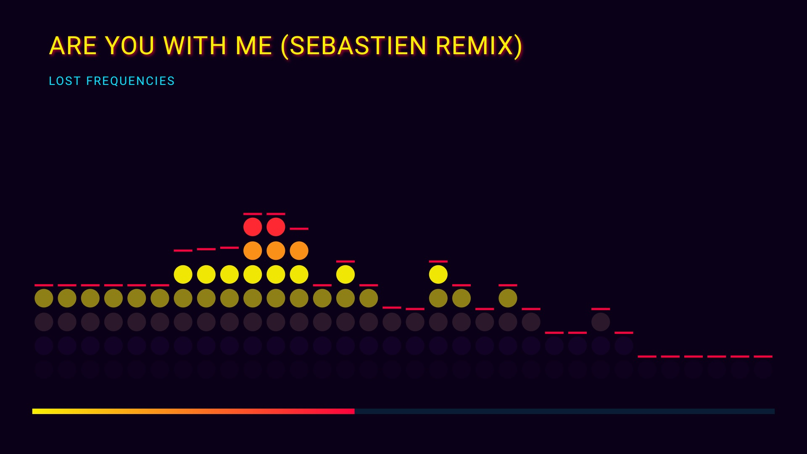 | 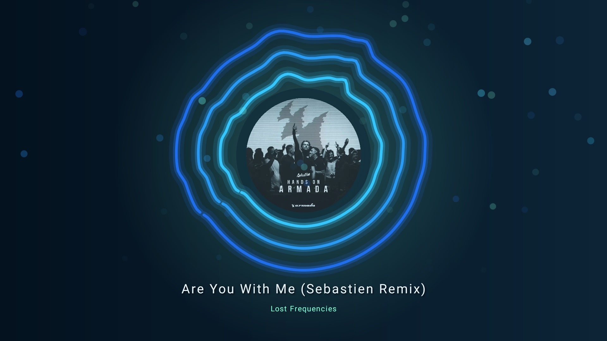 | 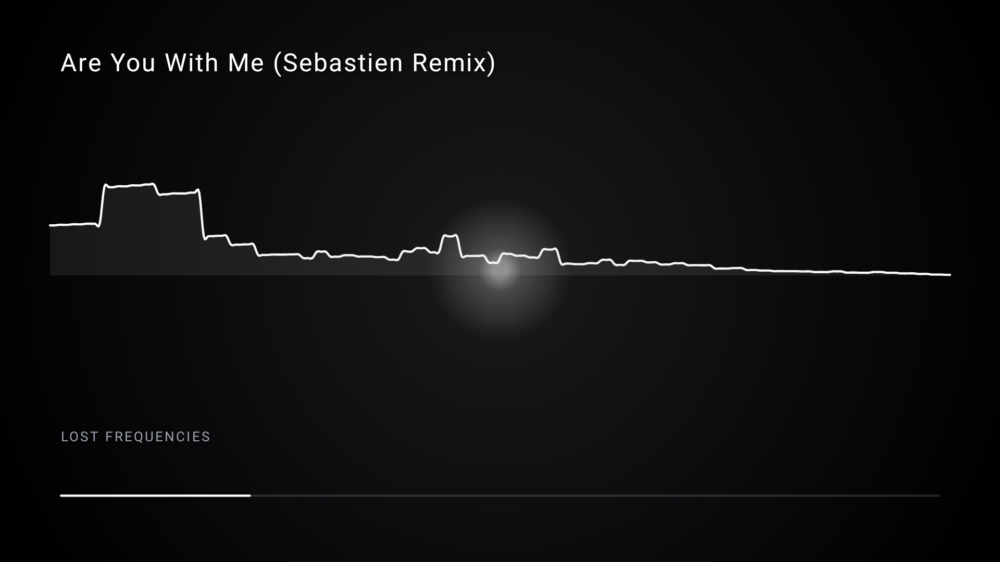 |
| Built-in: Cyber Grid | Built-in: Deep Ocean | Built-in: Neon Noir |
| 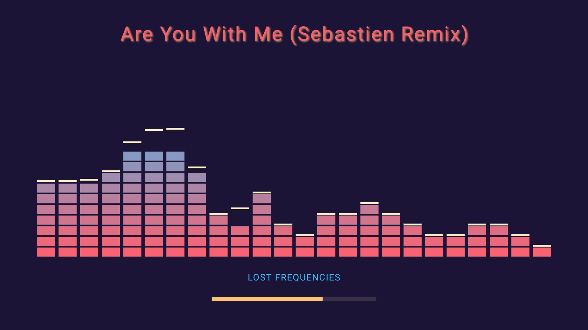 | 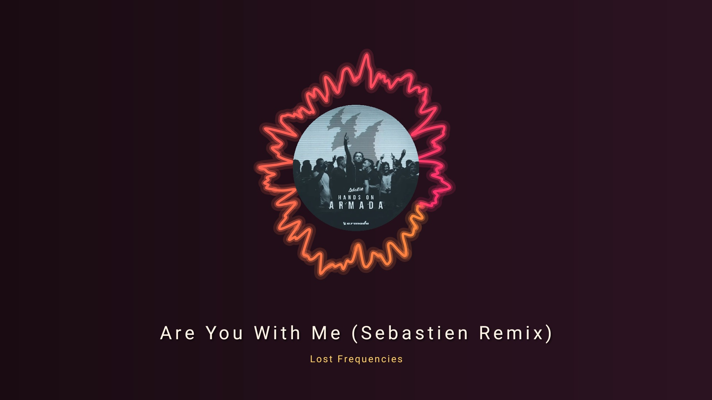 | 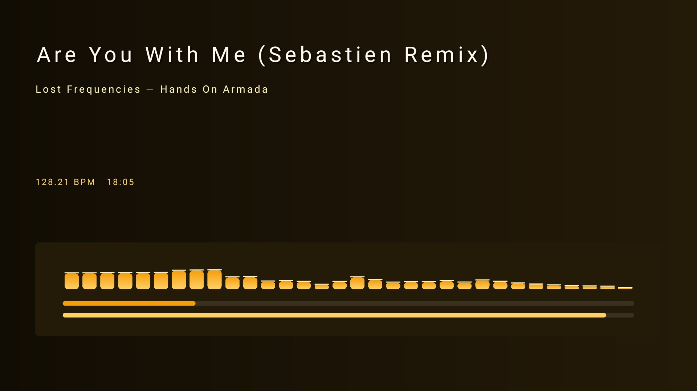 |
| Built-in: Retro Arcade | Built-in: Sunset Drive | Built-in: Studio Meters |
| 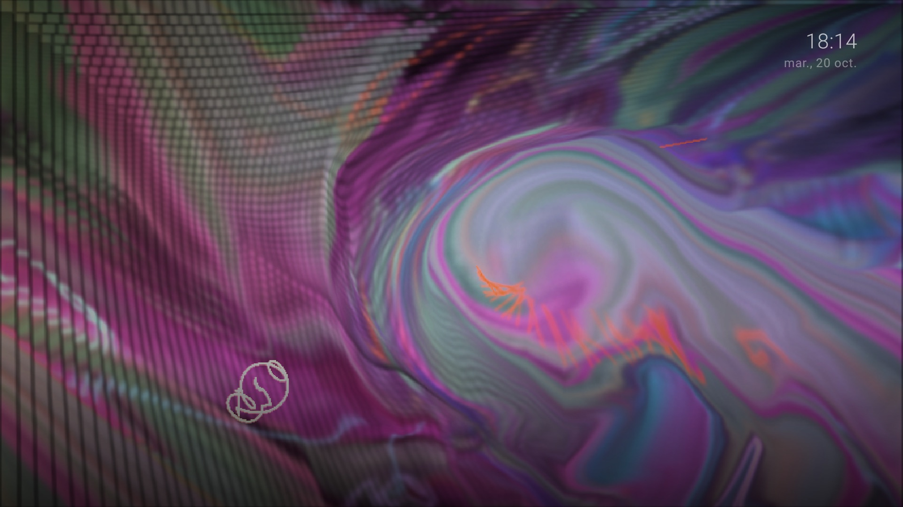 | 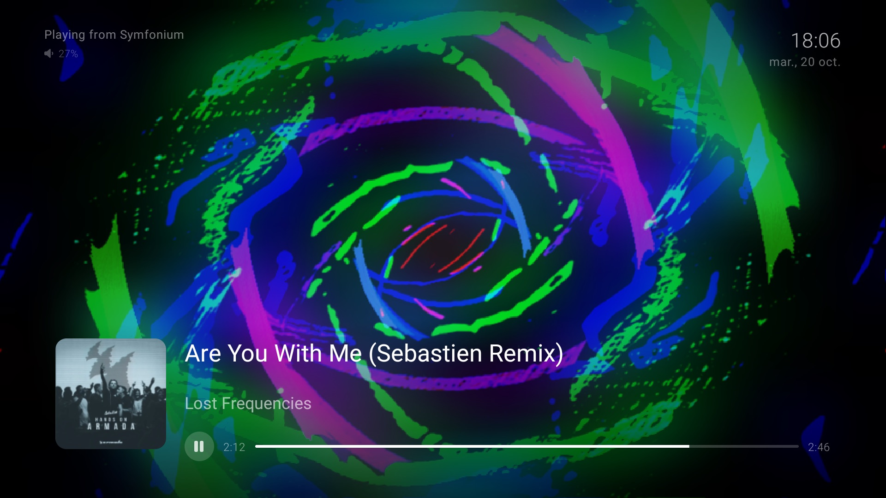 | 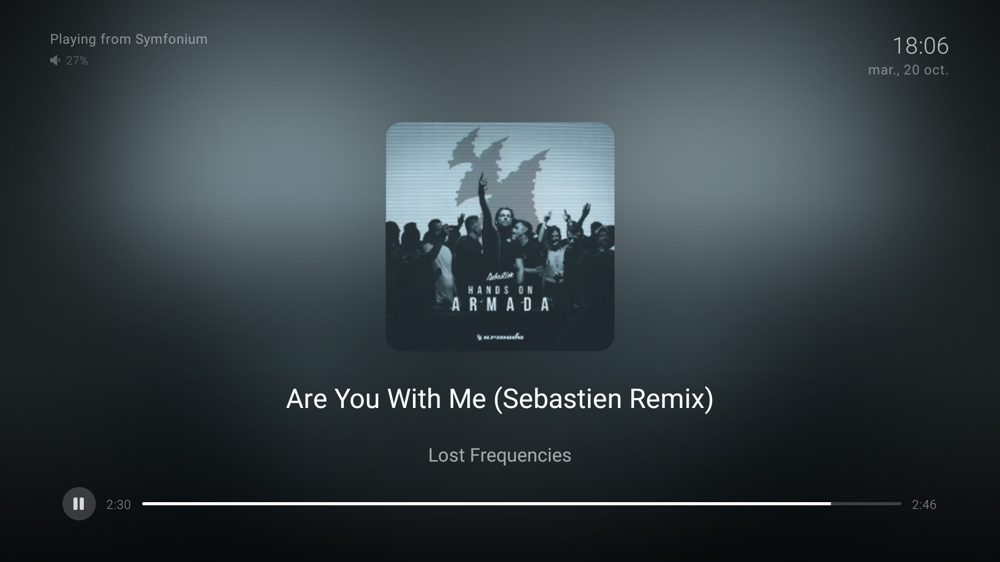 |
| Milkdrop (Classic pack) | Milkdrop (Butterchurn pack) | Visualizer switched off |

More built-in looks: [Ember Ring](docs/screenshots/builtin-ember-ring.jpg),
[Spotify TV](docs/screenshots/builtin-spotify-tv.jpg),
[Unknown Pleasures](docs/screenshots/builtin-unknown-pleasures.jpg).

## Web interface

Open `http://<tv-ip>:8092` on a phone connected to the same network. The page
is bundled in the app and works without internet.

<p align="center">
  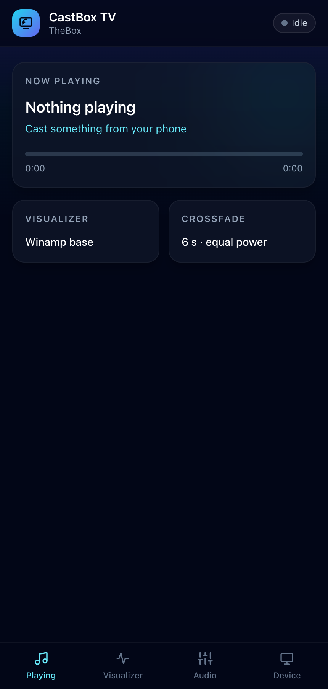
  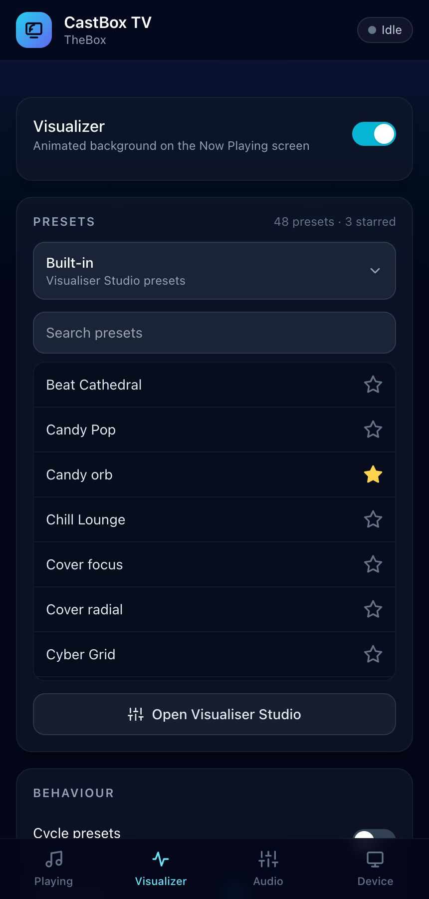
  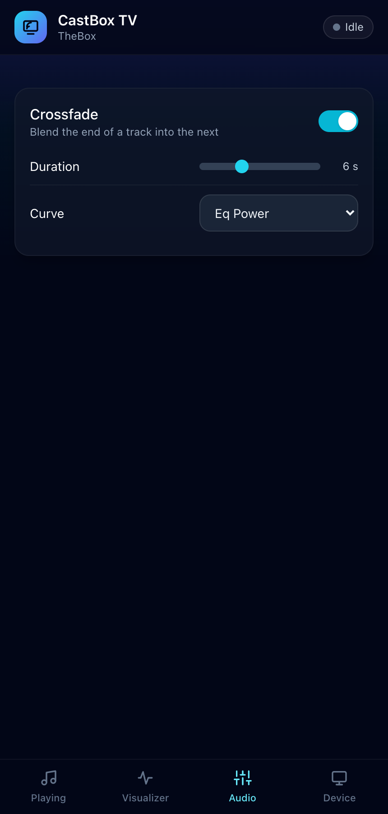
  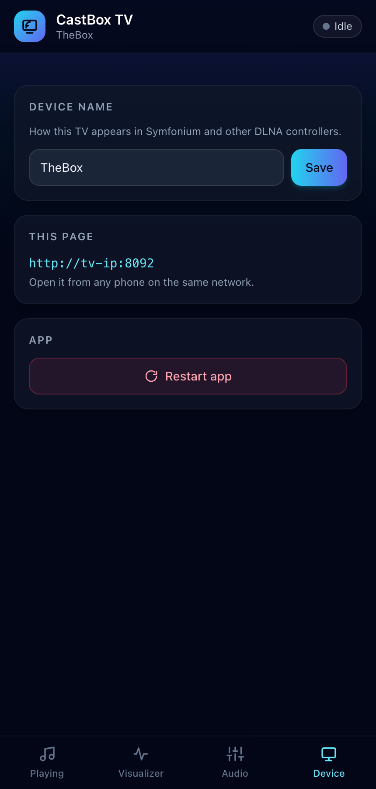
</p>

- **Playing:** current track, progress, visualizer and crossfade summary.
- **Visualizer:** on/off, then one Presets panel: a pack dropdown, a searchable list with a star on every preset,
  and a Favorites pack made of your starred presets from any pack,
  automatic cycling, cover-art colors.
- **Audio:** crossfade on/off, duration and curve.
- **Device:** the name shown to DLNA controllers, and an app restart.

## Visualiser Studio

A browser-based editor for the built-in presets, served by the app at
`http://<tv-ip>:8092/studio/`. Layer text, spectrum bars, rings, terrain and
images, bind colors to palette roles, preview with a test track or your mic,
and save presets straight to the TV.

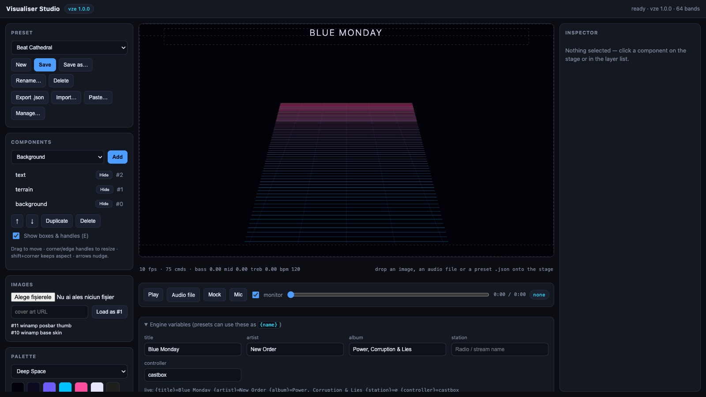

## Install

1. Download `castbox-tv.apk` from the [latest release](../../releases/latest).
2. Sideload it on the TV box:
   ```sh
   adb connect <tv-ip>:5555
   adb install -r castbox-tv.apk
   ```
3. Open **CastBox TV** once so the DLNA service starts, then pick the device
   from your controller app.

The app keeps a foreground service running so the TV stays discoverable.

## Build from source

Requirements: JDK 17, Android SDK (API 34) with the NDK and CMake 3.22.

```sh
echo "sdk.dir=/path/to/Android/Sdk" > local.properties
./gradlew :app:assembleDebug        # debug build
./gradlew :app:assembleRelease      # minified and signed, see below
```

Release signing reads `keystore.properties` (git-ignored):

```properties
storeFile=../my-release.jks
storePassword=...
keyAlias=...
keyPassword=...
```

### Web interface styles

The settings page uses Tailwind CSS, compiled ahead of time so the TV never
needs internet. After editing `app/src/main/assets/web/index.html` or `app.js`:

```sh
cd webui && npm install && npm run build
```

### Native library

`libprojectM-4.so` is vendored per ABI in `app/src/main/jniLibs/`. It is
projectM 4.1.7 built for GLES with one addition, `projectm_output_texture`
(declared in `app/src/main/cpp/include/projectM-4/render_opengl.h`), which the
JNI layer uses to blit the preset output.

## Project layout

```
app/                       Android app (Kotlin, Compose, Cling, Jetty, Media3)
  src/main/java/.../dlna   UPnP services and playback
  src/main/java/.../viz    visualizer engine, projectM bindings, audio tap
  src/main/java/.../web    web interface server
  src/main/assets/web      settings page (index.html, app.js, tailwind.css)
  src/main/assets/studio   built Visualiser Studio
  src/main/cpp             JNI wrappers (projectM, built-in engine)
visualizer/                Visualiser Studio sources and the shared C++ engine
webui/                     Tailwind build for the settings page
```

## Credits

projectM (LGPL-2.1), Cling and Jetty for UPnP, Media3 ExoPlayer, Coil and
Tailwind CSS. The Milkdrop and Butterchurn presets belong to their respective
authors, whose names are in the preset file names.
